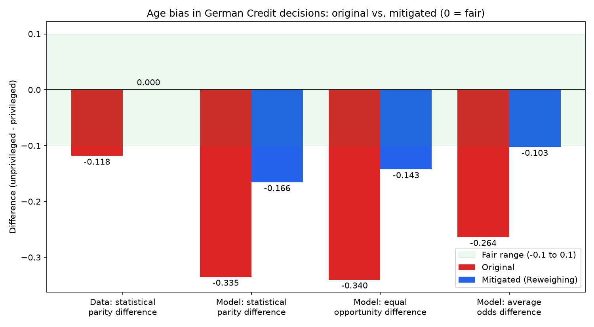

# Detecting and Mitigating Age Bias in Credit Decisions with AI Fairness 360

## Description
This project uses IBM's open-source [AI Fairness 360](https://github.com/Trusted-AI/AIF360)
(AIF360) toolkit to check the German Credit dataset for age bias and to reduce that bias
with the Reweighing algorithm. A logistic regression loan approval model is trained on the
original data and on the reweighed data, and both are compared for accuracy and fairness.

- Protected attribute: age
- Privileged group: applicants aged 25 or older
- Unprivileged group: applicants younger than 25
- Mitigation algorithm: Reweighing (pre-processing; Kamiran & Calders, 2012)

## Results (test set of 300 applicants)

| Metric                          | Original | Mitigated |
|---------------------------------|---------:|----------:|
| Accuracy                        |    0.760 |     0.757 |
| Approval rate, age 25 or older  |    0.782 |     0.771 |
| Approval rate, under 25         |    0.447 |     0.605 |
| Statistical parity difference   |   -0.335 |    -0.166 |
| Disparate impact                |    0.572 |     0.785 |
| Equal opportunity difference    |   -0.340 |    -0.143 |
| Average odds difference         |   -0.264 |    -0.103 |

Reweighing cut the approval gap between age groups roughly in half while accuracy
dropped by only 0.3 percentage points. Fair values are differences close to 0 and a
disparate impact close to 1.

## Files
- fairness_german_credit.py - measures bias, applies Reweighing, trains and compares models
- requirements.txt - manifest of required Python packages
- outputs/fairness_comparison.png - chart comparing original and mitigated fairness metrics

## How to Run
1. Create a virtual environment: python3 -m venv venv
2. Activate it: source venv/bin/activate
3. Install dependencies: pip3 install -r requirements.txt
4. Run: python3 fairness_german_credit.py

On the first run, the script downloads german.data from the
[UCI Machine Learning Repository](https://archive.ics.uci.edu/dataset/144/statlog+german+credit+data)
into AIF360's data folder, which AIF360 requires but does not include.

## Author
Aashish Sapkota
MSCS-633-A01 Advanced Artificial Intelligence, University of the Cumberlands
